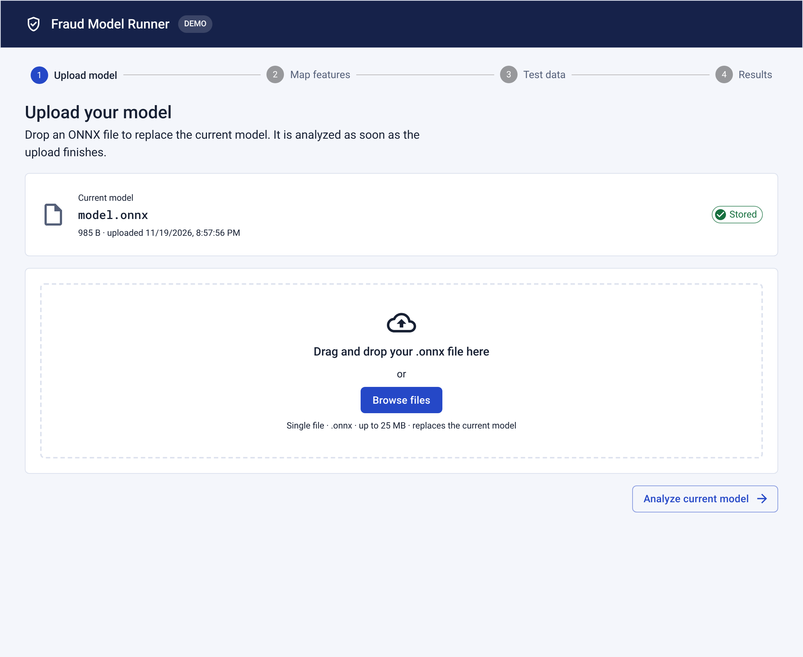
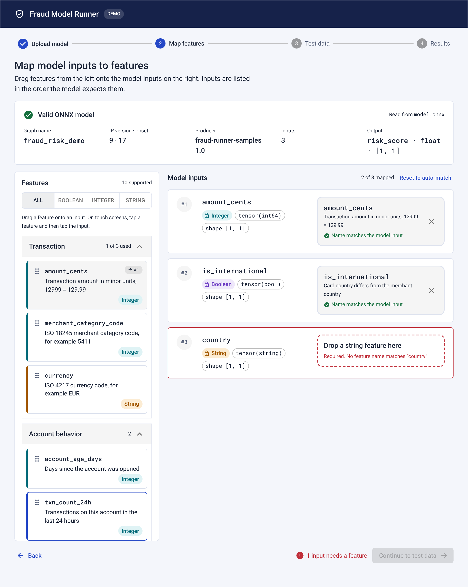
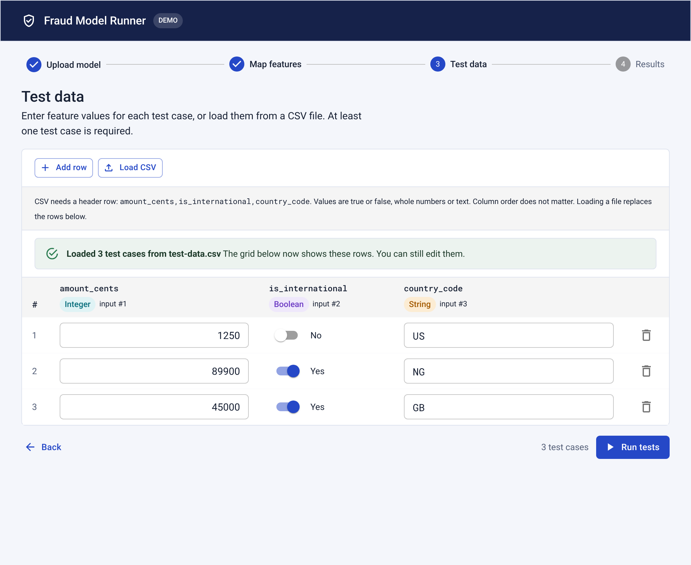
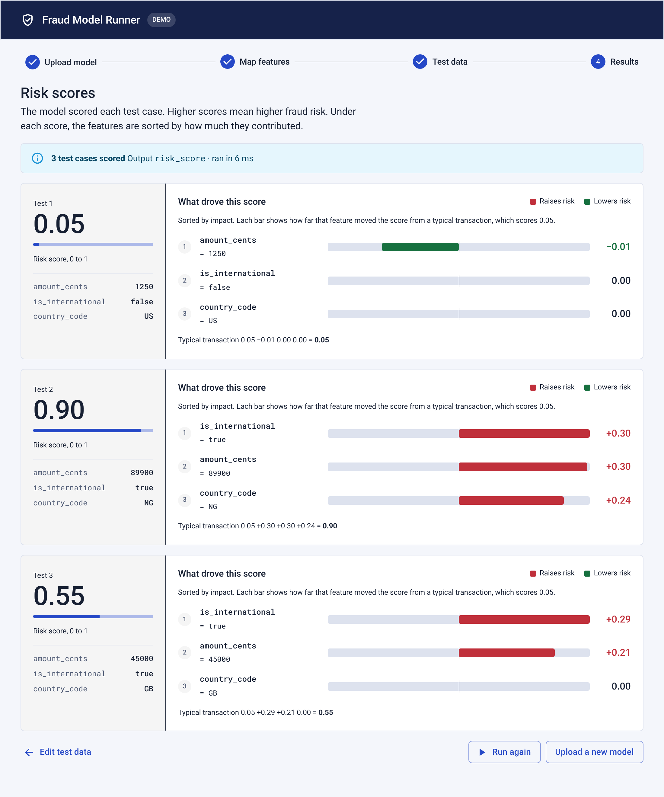

# Fraud Model Runner

A demo for scoring financial transactions with an ONNX fraud model. Upload a model, map its inputs to a fixed set of
10 transaction features, add test cases (by hand or from a CSV), and see the risk score for each case together with
the features that drove it, sorted by impact. Nothing else.

| 1. Upload | 2. Map features | 3. Test data | 4. Risk scores |
|---|---|---|---|
|  |  |  |  |

## How it works

```
Browser (React, MUI, Redux Toolkit)                       Azure
 ├─ static site  ────────────────────────────────────►  Storage account "ui"  ($web, static website)
 ├─ POST /api/upload-link  ──►  Container App (Spring Boot, Java 25, scale to zero)
 │                               ├─ mints a 15 min write-only SAS link for models/model.onnx
 │                               ├─ analyzes the model with ONNX Runtime
 │                               └─ runs test cases and computes feature contributions
 └─ PUT file with the SAS link ───────────────────────►  Storage account "models" (private)
                                                          └─ container "models" / blob model.onnx (always overwritten)
```

- **One model, always overwritten.** The blob name is fixed, so a new upload replaces the old model.
- **The upload link is never shown.** Dropping a file makes the UI fetch the link itself and upload straight to Blob
  Storage with `@azure/storage-blob`. The API never handles the file bytes on upload.
- **Analysis** validates the file (ONNX header and an ONNX Runtime session) and reports inputs (name, element type,
  shape), outputs and model metadata. Supported input types: `bool`, `int32`/`int64` and `string`, each holding a
  single value. The model must have one float output with a single score (an output named `risk_score` is preferred).
- **Features.** 10 fixed features of 3 types (3 Boolean, 4 Integer, 3 String), listed by `GET /api/features`. Each
  model input takes exactly one feature of the same type, and each feature is used once. Inputs whose name matches a
  feature (case and `_ - space` ignored) are matched automatically. Type and order of inputs cannot be changed.
- **Contributions** are exact Shapley values: each feature's average effect on the score compared with a baseline
  (typical) transaction. The service re-runs the model for every subset of features (2ⁿ runs per test case, at most
  1,024 with 10 features). Baseline values live in `FeatureCatalog.java`.
- **At least one test case** is required and a run takes at most 50.

## Sample model and test data

- [`samples/fraud-risk-demo.onnx`](samples/fraud-risk-demo.onnx): a small model with one input of each type:
  `amount_cents` (int64), `is_international` (bool) and `country` (string), returning `risk_score`.
  The input is called `country` on purpose: the other two inputs match automatically and this one shows the manual
  drag and drop to `country_code`.
- [`samples/test-data.csv`](samples/test-data.csv): three test cases for it. Use **Load CSV** on the test data screen,
  or copy the rows into the grid.

```csv
amount_cents,is_international,country_code
1250,false,US
89900,true,NG
45000,true,GB
```

Expected scores are about 0.05, 0.90 and 0.55. `samples/generate_model.py` regenerates both files and checks the model
against a reference formula (`pip install onnx onnxruntime numpy`).

CSV files need a header row with one column per mapped feature name. Column order does not matter. Booleans are
`true/false` (also `1/0`, `yes/no`), integers are whole numbers.

## Run locally

Needs Java 25, Node 22 and (for local blob storage) [Azurite](https://github.com/Azure/Azurite).

```bash
# 1. local blob storage
npx azurite-blob --skipApiVersionCheck --location /tmp/azurite

# 2. API on :8080 (the connection string is Azurite's public development account)
cd backend
export STORAGE_CONNECTION_STRING="DefaultEndpointsProtocol=http;AccountName=devstoreaccount1;AccountKey=Eby8vdM02xNOcqFlqUwJPLlmEtlCDXJ1OUzFT50uSRZ6IFsuFq2UVErCz4I6tq/K1SZFPTOtr/KBHBeksoGMGw==;BlobEndpoint=http://127.0.0.1:10000/devstoreaccount1;"
export STORAGE_CONFIGURE_CORS=true      # lets the browser upload to Azurite from localhost:5173
./gradlew bootRun

# 3. UI on :5173 (proxies /api to :8080)
cd frontend && npm ci && npm run dev
```

Tests: `cd backend && ./gradlew test` and `cd frontend && npm test`.
(On Java 25 ONNX Runtime asks for `--enable-native-access=ALL-UNNAMED`; without it you only see a warning.)

## Deploy to Azure

Everything is created in one new resource group and scales to near zero cost when idle:

| Resource | Setting that keeps cost down |
|---|---|
| Container App (API) | consumption plan, 0 to 2 replicas, 0.5 vCPU / 1 GiB, **scales to zero** |
| Storage account, models | Standard LRS, private, shared key disabled (user delegation SAS only) |
| Storage account, UI | Standard LRS, static website |
| Container Registry | Basic |
| Log Analytics | 30 days, 0.1 GB per day cap |

The first request after the API has been idle takes a few seconds while a replica starts.

**One-time setup** (needs permission to create resource groups and app registrations):

```bash
az login
infra/bootstrap.sh <github-owner>/<repo> eastus
```

This creates the resource group `rg-fraudrunner-demo`, an Entra app registration that GitHub Actions signs in as
through OIDC (no password stored), grants it Contributor and User Access Administrator on that one resource group, and
saves `AZURE_CLIENT_ID`, `AZURE_TENANT_ID` and `AZURE_SUBSCRIPTION_ID` as repository secrets.

**After that, every push to `main` deploys everything** (`.github/workflows/deploy.yml`):

1. `infra`: Bicep (`infra/main.bicep`) creates storage, registry, identity and the container environment.
2. `backend`: tests, builds the image, pushes it to the registry, then deploys the container app with that image.
3. `frontend`: tests, builds the UI against the API URL, enables the static website and uploads it.

The job summary shows the UI and API URLs. `.github/workflows/ci.yml` builds and tests every other branch and pull
request.

## Project layout

```
backend/    Spring Boot 4, Java 25, Gradle. api/ (HTTP), onnx/ (analysis, inference, contributions), storage/ (blob), feature/
frontend/   React 19, MUI, Redux Toolkit (RTK Query). features/ upload, mapping, tests, results
infra/      main.bicep and bootstrap.sh
samples/    pre-generated ONNX model, test CSV and the script that makes them
docs/       screenshots
```

## HTTP API

| Method and path | Purpose |
|---|---|
| `GET /api/features` | the 10 supported features (name, type, category, description, baseline) |
| `GET /api/model` | whether a model is stored, its size and last change |
| `POST /api/upload-link` | a 15 minute write-only SAS URL for the model blob |
| `GET /api/model/analysis` | validity, inputs, outputs and metadata of the stored model |
| `POST /api/model/test-run` | scores and sorted feature contributions for the given test cases |
